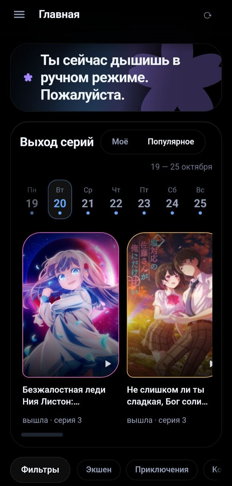
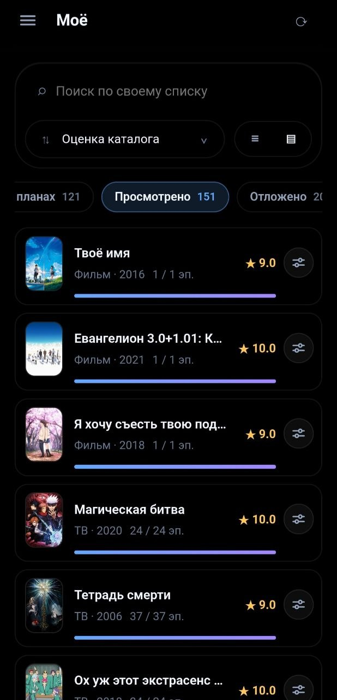
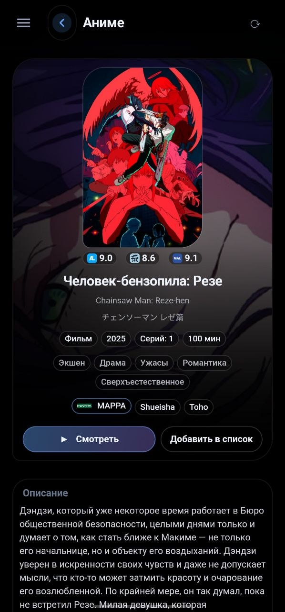

<div align="center">


# AniMori

### Смотрите аниме и ведите списки — на ПК, ТВ и телефоне

Неофициальный клиент AniList для Windows, Android TV и телефона. Перевод контента — Shikimori.

[](LICENSE)
[](apps/windows)
[](apps/android-tv)
[](apps/android)


**[Скачать для Windows](https://github.com/foulnike/Animori/releases/latest)** ·
**[Скачать APK для Android TV](https://github.com/foulnike/Animori/releases/tag/android-tv-v3.1.2)** ·
**[Скачать APK для телефона](https://github.com/foulnike/Animori/releases/tag/android-v3.1.2)** ·
[Сборка из исходников](#сборка)

</div>

## Актуальные версии

| Приложение | Версия | Скачать |
| :--- | :--- | :--- |
| **Windows** 10/11 | 3.1.2 | [установщик, MSI, портативный архив](https://github.com/foulnike/Animori/releases/latest) |
| **Android TV** 7.0+ | 3.1.2 | [APK arm64 и armv7](https://github.com/foulnike/Animori/releases/tag/android-tv-v3.1.2) |
| **Телефон** (Android 7.0+) | 3.1.2 | [APK arm64 и armv7](https://github.com/foulnike/Animori/releases/tag/android-v3.1.2) |

## Связь с разработчиком

Вопросы, предложения, баг-репорты — в группе Telegram: https://t.me/foulnike_backrooms

---

> [!WARNING]
> **Видеоисточники.** Встроенный плеер открывает потоки сторонних сервисов
> (Kodik, Anilibria), не связанных с AniMori и не являющихся
> правообладателями. Программа не размещает, не хранит и не копирует
> видеоматериал, лицензий на него не получает и прав на распространение не
> имеет; источники не проверяются, законность и доступность контента не
> гарантируются. За выбор источника и за просмотр отвечает пользователь.
> Подробнее — [Условия использования](docs/TERMS.md), раздел «Сторонний
> контент и видеоисточники».

## Настольное приложение

**Windows 10/11**. Установщик, MSI или портативный архив без
установки — в [выпусках](https://github.com/foulnike/Animori/releases/latest).

<table>
  <tr>
    <td width="50%"><br><sub><b>Список.</b> Хранится на устройстве, открывается без сети.</sub></td>
    <td width="50%"><br><sub><b>Тайтл.</b> Русское описание, кадры, трейлер, персонажи, опенинги.</sub></td>
  </tr>
  <tr>
    <td width="50%"><br><sub><b>Статистика.</b> Время просмотра, ваши оценки против оценок сообщества.</sub></td>
    <td width="50%"><br><sub><b>Настройки.</b> Темы, перенос списка, прокси, журнал отладки.</sub></td>
  </tr>
</table>

Перенос списка — из AniList, с Шикимори по нику или файлом выгрузки MyAnimeList.
Экспорт — в тот же XML, который принимают AniList, Шикимори и Kitsu, или копия в облако.
Смотрите в отдельном окне или передавайте на телевизор.
Подробности — в [apps/windows](apps/windows).

## Приложение для телевизора

**Android TV, Android 7.0 и новее**.

<table>
  <tr>
    <td width="50%"><br><sub><b>Календарь.</b> Что и когда выйдет у того, что вы смотрите.</sub></td>
    <td width="50%"><br><sub><b>Рекомендации.</b> Подборки главной к настроению.</sub></td>
  </tr>
  <tr>
    <td width="50%"><br><sub><b>Списки.</b> Статусы, оценки и поиск по своему списку.</sub></td>
    <td width="50%"><br><sub><b>Карточка.</b> Русское описание, кадры, персонажи.</sub></td>
  </tr>
</table>

APK в [выпусках](https://github.com/foulnike/Animori/releases):
`AniMori_3.1.2_armv7.apk` для 32-разрядных приставок и `AniMori_3.1.2_arm64.apk`
для 64-разрядных.
Подробности — в [apps/android-tv](apps/android-tv).

## Приложение для телефона

**Android 7.0 и новее**.

<table>
  <tr>
    <td width="33%"><br><sub><b>Главная.</b> Календарь выхода, продолжение просмотра, полки.</sub></td>
    <td width="33%"><br><sub><b>Списки.</b> Статусы, оценки и поиск по своему списку.</sub></td>
    <td width="33%"><br><sub><b>Карточка.</b> Русское описание, кадры, персонажи.</sub></td>
  </tr>
</table>

APK в [выпусках](https://github.com/foulnike/Animori/releases):
`AniMori_3.1.2_arm64.apk` для 64-разрядных телефонов и `AniMori_3.1.2_armv7.apk`
для 32-разрядных.
Подробности — в [apps/android](apps/android).

## Сборка

Нужен Node.js 24 или новее (npm 11): lock репозитория сгенерирован npm 11 и не
встаёт под npm 10 с Node 20/22. Для Android дополнительно Android SDK и NDK.

```bash
npm ci
npm test
npm run typecheck
```

Разработка — из каталога приложения:

```bash
cd apps/windows   && npm run tauri dev
cd apps/android-tv && npm run tauri -- android dev
cd apps/android   && npm run tauri -- android dev   # туннель adb: см. apps/android
```

Выпуск делается тегом: `windows-v3.1.2`, `android-tv-v3.1.2` или `android-v3.1.2`.

## Устройство репозитория

| Каталог | Что в нём |
| :--- | :--- |
| `packages/core` | Общее ядро: данные, снимок, облачная копия, видео |
| `apps/windows` | Настольное приложение: экраны и оболочка |
| `apps/android-tv` | Приложение для телевизора: экраны и оболочка |
| `apps/android` | Приложение для телефона: экраны и оболочка |
| `docs` | Документация: правовая и для разработчиков — [оглавление](docs/README.md) |

## Лицензия

[MIT](LICENSE). Зависимости приходят со своими лицензиями — перечень в
[THIRD-PARTY.md](docs/THIRD-PARTY.md), он собирается из `package-lock.json`. Русские названия и
описания приходят из [Shikimori](https://shikimori.one);
датасет собирается в [animori-data](https://github.com/foulnike/animori-data). Проект
неофициальный и с командой AniList не связан.

> [!WARNING]
> В разработке приложения принимали участие нейросети.

## Правовые документы

- [Политика обработки персональных данных](docs/PRIVACY.md) (русская и английская версии)
- [Условия использования](docs/TERMS.md) (русская и английская версии)
- [Безопасность](docs/SECURITY.md) — как сообщить об уязвимости
